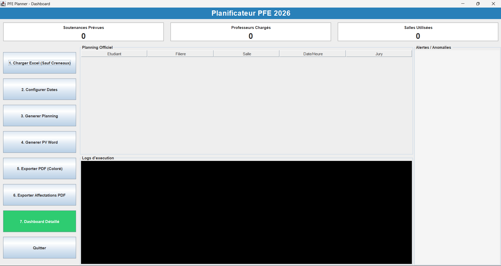
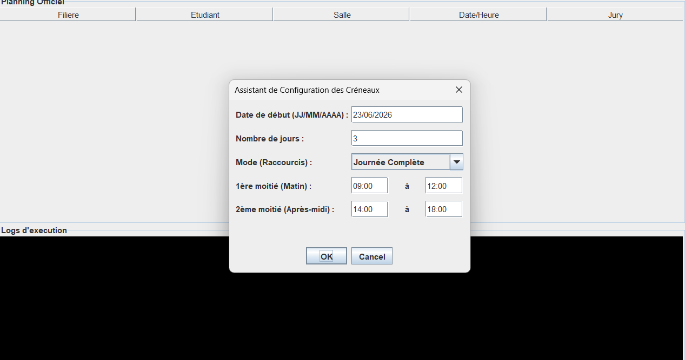
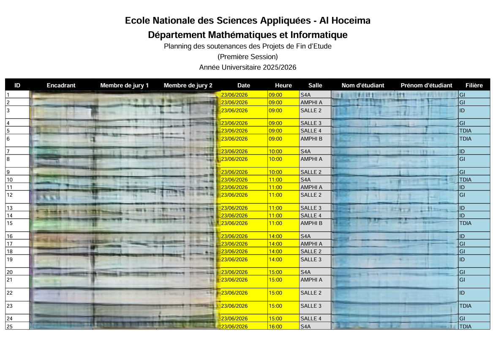
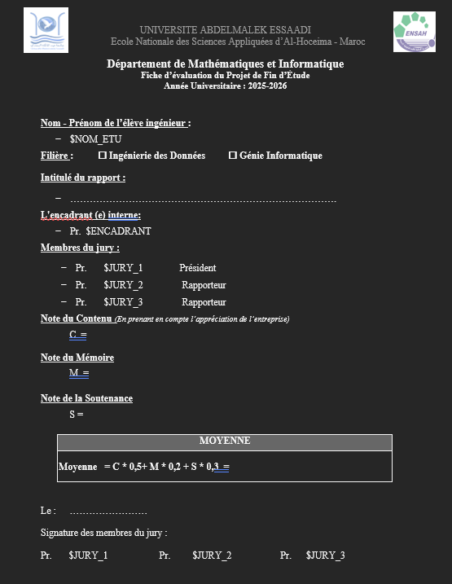

# 🎓 PFE Planner - Système d'Affectation Académique Intelligent


**PFE Planner** est une application Desktop en Java développée pour automatiser, optimiser et sécuriser le processus de planification des soutenances de Projets de Fin d'Études (PFE). Conçu avec une approche **Data-Driven**, le système lit une source de données unique (Excel) et génère des plannings optimisés sous de multiples contraintes tout en produisant les documents administratifs officiels (PV Word, Affectations PDF).

---

## 📸 Aperçu de l'Application

*(Ajoutez ici vos captures d'écran dans le dossier du projet et remplacez les noms des images ci-dessous)*

| Interface Principale | Paramétrage Dynamique |
| :---: | :---: |
|  |  |
| *Tableau de bord de planification interactive* | *Assistant de configuration Fail-Fast* |

| Export PDF Coloré | Génération des PV |
| :---: | :---: |
|  |  |
| *Légende et identification par hachage de couleur* | *Création de documents officiels par publipostage* |

---

## 🚀 Fonctionnalités Clés & Architecture

L'application a été structurée pour respecter des standards élevés en ingénierie logicielle :

*   **Principes SOLID (OCP) :** Aucune valeur métier n'est "hardcodée". La taille des jurys, les durées des soutenances et les règles de priorité (équité) sont configurées dynamiquement via un onglet *Configuration* dans l'Excel source.
*   **Approche Fail-Fast :** Le système vérifie mathématiquement les capacités physiques (Heures disponibles × Salles disponibles) par rapport au nombre d'étudiants. S'il détecte une impossibilité physique, il refuse la génération et alerte l'utilisateur pour éviter tout plantage ou planning incohérent.
*   **Load Balancing (Équité des charges) :** Un algorithme avancé répartit les étudiants entre les professeurs pour garantir un nombre de soutenances équitable pour chaque enseignant.
*   **Système d'Aide à la Décision (SAD) :** L'algorithme *suggère* un planning optimisé, mais garde une interface interactive permettant à l'utilisateur de forcer ou corriger une affectation manuellement (ex: salle inondée, jury absent) avant validation finale.
*   **Algorithme Double Passe (Binômes) :** Fusion automatique des soutenances pour les étudiants travaillant en binôme (même date, même jury, même salle).

---

## ⚙️ Installation & Lancement

### Prérequis
*   Java JDK 21 ou supérieur
*   Maven (pour la gestion des dépendances)
*   IDE recommandé : Eclipse, IntelliJ IDEA ou VS Code

### Instructions
1. Clonez ce dépôt :
   ```bash
   git clone https://github.com/RedaELMOR/PFE-PLANNER.git
   ```
2. Ouvrez le projet dans votre IDE et mettez à jour les dépendances Maven (`pom.xml`).
3. Lancez la classe principale :
   `src/ma/ensah/pfe/ui/MainWindow.java`

---

## 📖 Comment l'utiliser (Workflow)

1. **Chargement des données** : Cliquez sur *"1. Charger Excel"* pour ingérer les listes (Étudiants, Professeurs, Salles) et les paramètres de configuration métier.
2. **Configuration du calendrier** : Cliquez sur *"2. Configurer Dates"*. Le système analysera les besoins et validera la faisabilité physique (Fail-Fast).
3. **Génération (SAD)** : Cliquez sur *"3. Générer Planning"*. Un tableau interactif s'affiche.
4. **Validation Humaine** : Double-cliquez sur n'importe quelle cellule du planning généré pour forcer une modification manuelle si nécessaire.
5. **Exports Officiels** :
   * *"Générer PV (Word)"* : Crée un fichier `.docx` par étudiant pour l'administration.
   * *"Exporter PDF (Coloré)"* : Crée un tableau visuel global avec un code couleur généré dynamiquement pour chaque professeur.
   * *"Exporter Affectations PDF"* : Crée un rapport de répartition des encadrants avec légendes colorées selon les filières (ID, TDIA, GI).

---

## 🛠️ Stack Technique

*   **Langage :** Java (JDK 21)
*   **Lecture/Écriture Excel & Word :** Apache POI
*   **Génération PDF :** iText PDF
*   **Interface Graphique :** Java Swing
*   **Gestion de projet :** Maven

---
**Développé par :** Mohamed Reda EL MORABIT,.
